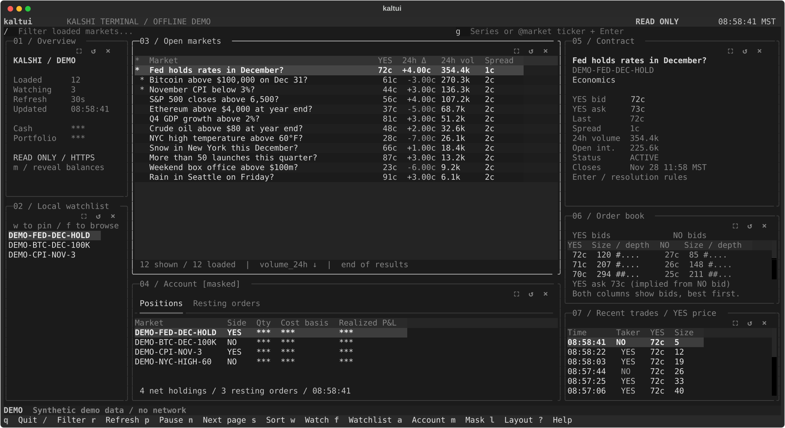

# kaltui

**Kalshi TerminalUI** — a minimal, read-only terminal dashboard inspired by
[btop](https://github.com/aristocratos/btop), [htop](https://htop.dev/),
[lazygit](https://github.com/jesseduffield/lazygit), and [rhtop](https://rhtop.dev).

Browse prediction markets, inspect bid ladders and recent trades, pin a local
watchlist, and optionally read your own portfolio. Compact bordered panels,
muted colors, green and amber accents, and keyboard navigation keep the focus on data.



## Run

Python **3.11+** and an interactive terminal are required. On Unix:

```sh
./run.sh --demo   # synthetic offline data
./run.sh          # live public markets; no API key required
```

The launcher creates `.venv` and installs `requirements.txt` on the first run.
Initial setup needs internet access; subsequent demo runs are fully offline.
To set up the environment explicitly:

```sh
python3 -m venv .venv
.venv/bin/python -m pip install -r requirements.txt
./run.sh --demo
```

You can also install this checkout with `pipx install .` or `python -m pip install .`
inside your own virtual environment, then run `kaltui`. The installed command
works independently of the source checkout.

```sh
./run.sh --series KXHIGHNY    # start with one series
./run.sh --poll-seconds 60   # market refresh interval, 10–3600 seconds
./run.sh --public            # ignore any configured account credentials
./run.sh --no-save           # do not read or write local preferences
./run.sh --paths             # print the preferences path
./run.sh --help
```

The default three-column layout shows Overview and a local watchlist on the
left, markets and optional account tables in the center, and contract details,
an order book, and recent trades on the right. **160×42** is comfortable for all
panels. Below 115 columns the sidebar is hidden; below 75 columns panels stack
vertically and scroll. `l` switches to the stacked layout at any width. Tables
support horizontal scrolling when columns cannot fit.

## Controls

| Key | Action |
| --- | --- |
| `Tab` / `Shift+Tab` | Focus next / previous control |
| Arrows / `j`, `k` | Navigate table rows; highlighting a market loads its details |
| `Enter` | Inspect resolution rules or an account row |
| `/` | Filter loaded markets by title, subtitle, or ticker |
| `Esc` | Clear the filter / close an overlay |
| `g` | Focus the series / exact-market lookup field |
| `n` | Load the next market page |
| `s` / `S` | Cycle the sort column / reverse sort direction |
| Click column header | Sort by title, price, volume, or spread |
| `w` | Add / remove the selected market from the local watchlist |
| `f` | Switch between the market catalog and local watchlist |
| `a` / `4` | Show / hide account tables |
| `1`–`7` | Show / hide the matching numbered panel |
| `m` / `Ctrl+h` | Mask / reveal personal financial values |
| `r` | Refresh / retry, including while paused |
| `p` | Pause / resume automatic refresh |
| `l` | Switch classic / stacked layout |
| `?` | Keyboard reference |
| `q` / `Ctrl+c` / `Ctrl+q` | Quit; control-key shortcuts also work inside inputs |

Each panel has three icon buttons: `⛶` expands it to the workspace (click again
to restore), `↺` resets its size and scroll position, and `×` hides it. Its number
key restores a hidden panel. At least one panel stays visible. Panel visibility
and expansion are session-only; reset leaves data and watchlist pins intact.

Inputs consume normal character keys while typing. Use Tab or Esc to return to
dashboard shortcuts. The clock continues ticking while polling is paused.

In the lookup field, type a **series ticker** such as `KXHIGHNY` and press Enter.
For one exact contract, prefix its full ticker with `@`. Clear the field and
press Enter to return to open markets. The `/` filter searches **loaded rows**,
not the entire exchange. Clear it when changing the scope if needed.

The catalog loads 200 markets at a time, excludes multivariate combo markets,
and sorts locally by 24-hour volume initially. A footer reports how many rows
are loaded and whether more pages are available. Press `n` to load more.
Refresh revisits loaded pages; it does not silently treat earlier pages as fresh.
Watchlist reads fetch pinned tickers directly and can include closed markets.
Pins are local public ticker preferences, never Kalshi watchlist mutations.
Demo and live pins are saved separately, with up to 100 pins in each.

## Optional account views

Market browsing works without credentials. To read your account, supply a Kalshi
API key ID and the path to its private key using environment variables:

```sh
export KALSHI_API_KEY_ID='your-key-id'
export KALSHI_PRIVATE_KEY_PATH="$HOME/.config/kalshi/private-key.pem"
./run.sh
```

Create and manage your own key through [Kalshi's account settings](https://kalshi.com/account/profile).
Both **RSA-PSS/SHA-256** and **Ed25519** keys are supported. The key file must be
an unencrypted PEM. Keep it outside the repository. kaltui loads the specified
key into memory and signs account GET requests; it never uploads the private key,
creates keys, or stores credentials. `.env` files are not loaded.
`--public` and `--demo` ignore these variables and never open the key file.
Signing follows [Kalshi's authentication documentation](https://docs.kalshi.com/getting_started/api_keys).

Account views show available cash, the API's positions portfolio value,
non-zero net **unsettled positions** (including closed markets awaiting settlement),
and **resting orders**. Position exposure is labeled **cost basis**, not current
market value. Realized P&L comes directly from Kalshi. Historical/settled
positions, completed orders, subaccount selection, and fills are not included.
Account reads refresh at most once per minute automatically, and on `r`.
Positions and orders show the first 200 results, with a visible partial-results
warning when a cursor remains. Failed account sections clear their values and
report the failure instead of showing zeroes.

Privacy starts **on at every launch**. Cash, position value, quantities, cost
basis, P&L, and personal order prices show `***`. Market symbols, sides, actions,
and row counts remain visible. `m` reveals values for the current session only;
`Ctrl+h` also works inside inputs and closes any open account detail overlay.
Masking is a display control, not an anonymization mode.

## Data and read-only behavior

All API traffic is HTTPS **GET** against an explicit endpoint allowlist. The
transport guard blocks other methods, hosts, ports, and routes, and redirects
are disabled. The only signed routes are balance, positions, and orders reads.
There are no trading actions, previews, cancellations, or order builders.

Data comes from [Kalshi's public REST API](https://docs.kalshi.com/getting_started/quick_start_market_data).
This dashboard polls snapshots; it does not use streaming WebSockets. Prices and
status can lag the exchange. Selection reads the individual market, order book,
and most recent 16 public trades. Rapid navigation cancels superseded detail reads.

The order book displays **YES bids and NO bids**, highest first. Neither column
is an ask ladder. The implied YES ask is `$1 − best NO bid`, as described in
[Kalshi's order-book reference](https://docs.kalshi.com/api-reference/market/get-market-orderbook).
The trade tape always shows YES prices; the taker column identifies the outcome
side. `24h Δ` is the change in cents from Kalshi's previous price, not a percentage
return. Fixed-point dollar prices and fractional contract quantities use decimal
arithmetic. Missing or invalid values show `--`, while real zeroes remain zeroes.

A failed catalog refresh keeps the last successful snapshot and marks it
**STALE**. Automatic retries back off, and HTTP 429 honors a bounded
`Retry-After` delay. Failed contract/book/tape reads report their own warnings.
Live mode never substitutes synthetic demo data. The demo is deterministic,
fictional, and makes no network requests after installation.

Only public watchlist tickers, layout, and refresh interval are saved, atomically,
with file mode `0600` on Unix. New config directories use `0700`.
The default path on Linux is `~/.config/kaltui/settings.json`;
demo uses `demo-settings.json`. XDG directory variables are respected.
Use `--paths` to locate the file or `--no-save` for an ephemeral session.
No account responses or market snapshot history are written to disk.

## Development

```sh
.venv/bin/ruff check src tests
.venv/bin/ruff format --check src tests
.venv/bin/python -m pytest -q
.venv/bin/python -m build --no-isolation
```

Tests use mocked HTTP transports and Textual's headless pilot with synthetic
data. They cover the GET-only boundary, request signatures, precision, rate
limits, keyboard navigation, masking, watchlists, pagination, and stale data.
No live account credentials are used by tests.

`client.py` owns HTTP access; `auth.py` owns in-memory signing; `parsing.py` and
`models.py` normalize API data. `ui/` contains the dashboard, formatting, and
overlays. `settings.py` handles public local preferences. `demo.py` is an isolated
synthetic reader using the same models as live mode.

## License

kaltui is published under [PolyForm Noncommercial 1.0.0](LICENSE).
Public redistribution and permitted noncommercial use are free of charge;
commercial use is restricted. See
[NOTICE](NOTICE) and [SECURITY.md](SECURITY.md).

This project is independent of and is not endorsed by Kalshi Inc.
